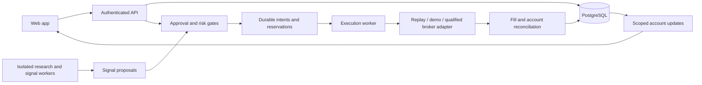

# Product and architecture proposal

The current general diagram and build/reuse/cost inventory are maintained in SYSTEM-BLUEPRINT.md. Use that file as the implementation map and update decisions there when vendors or components are selected.

Status: draft for discussion, 3 November 2026. Confirmed audience: both beginners and experienced traders. Confirmed visual direction: dark professional terminal with a light option. Application name, first broker, market-data provider, identity provider, and hosting are not finalized. A local design prototype exists under prototype/; no production application runtime or live trading is implemented.

## First usable milestone

A user opens a clearly labeled paper account, views a watchlist and chart, enables a versioned research strategy in paper mode, chooses approval-required or automatic execution, and follows the resulting orders, positions, risk usage, and activity history. The system explains rejected proposals and reconnect/reconciliation states.

Start with a clearly labeled deterministic replay dataset and a paper adapter. Broker demo integration follows qualification. Replay, broker-demo, and live results must have distinct labels and environments. Synthetic or replay data must not be represented as current market prices or actual profitability.

The architecture anticipates forex, equities, gold, and oil; executable instruments enter the milestone only after their specifications and data are implemented. First data fixtures should exercise EURUSD, a JPY pair, and a US equity. Gold/oil contracts remain a product decision.

## User experience draft

Confirmed audience: both new and experienced traders, with a concise overview and a detailed workspace. Use a dark professional terminal theme by default and provide a light theme. The local prototype uses Axiom as a provisional name, pending branding discussion.

Navigation: Overview, Trade, Strategies, Activity, Risk, Connections & Security.

| Screen | Primary task | Required visible information |
| --- | --- | --- |
| Overview | Understand the account and what needs attention | Selected account/environment, equity, realized/unrealized P&L, exposure, pending approvals, data/connection freshness |
| Trade | Inspect an instrument and place or review an order | Watchlist, chart, bid/ask, timestamps, exact instrument/product type, order ticket, estimated costs/risk, positions and working orders |
| Strategies | Understand and control a strategy | Version, precise rule summary, research assumptions, results provenance, paper/automatic/approval state, instruments, configured limits |
| Activity | Explain what happened | Signals, approvals, risk decisions, submissions, broker/paper acknowledgements, fills, cancellations, rejected and unknown outcomes |
| Risk | Set and inspect controls | Trade/account/strategy limits, gross/net exposure, drawdown conventions, currency concentration, stop-new-orders control |
| Connections & Security | Manage access | Eligible broker integrations, authorization status, last sync, revocation, MFA/session controls, explicit permission for automation |

Trade workspace layout: persistent account/environment header; watchlist on the left, chart in the center, order ticket on the right; positions/orders below. On smaller web screens these become tabs with the environment and connection state always visible. Numeric fields use aligned tabular digits and show currency/units. Statuses use text and icons as well as color. Full keyboard operation is required for order entry and confirmation.

Approval flow: signal -> precise proposed order and estimated risk -> user approval or expiry -> fresh authorization, quote and risk checks -> execution or explicit rejection. If material order terms change, require a new approval. Automatic mode uses the same risk gates and requires an explicit account/strategy permission.

Stopping new orders, cancelling pending orders, and closing positions are separate actions with separate effects. Connection loss cannot be displayed as a successful cancellation or a closed position.

## Proposed technology choices

| Component | Initial proposal | Rationale / decision boundary |
| --- | --- | --- |
| Web | React, TypeScript, Next.js | Typed interactive screens and routing. Keep trading decisions in the Python backend. Confirm versions at implementation. |
| Styling | CSS design tokens and reusable accessible components | Support dark/light themes and consistent dense numeric screens; component library remains open. |
| Charts | TradingView Lightweight Charts | Open-source chart candidate; implement our own order UI and data adapter. Check license/attribution requirements before shipping. It supplies neither broker connectivity nor market-data rights. |
| API | Python, FastAPI, Pydantic | Typed request/response validation and an OpenAPI contract for frontend clients. |
| Persistence | PostgreSQL, SQLAlchemy, Alembic | Transactional account, intent, order, approval, and event state with versioned migrations. Specific libraries remain proposed until implementation checks. |
| Research | Python workers, Parquet; DuckDB/Polars as needed | Keep historical scans and CPU work separate from interactive API and execution workers. Benchmark before adding a specialized time-series database. |
| Execution | Dedicated Rust worker, durable intents/journal, broker adapter interface | Accepted language direction. Evaluate NautilusTrader reuse and persistence/reconciliation semantics before writing a new engine. No broker secrets in the browser or strategy sandbox. |
| Streaming | Authenticated backend WebSockets | Account-scoped updates with sequence/cursor and snapshot recovery; price freshness is explicit. |
| Identity | Maintained OIDC identity service, provider to be selected | MFA, session lifecycle, recovery, and revocation; app verifies account authorization independently. |
| Secrets | Hosting-provider secret manager/KMS, provider to be selected | Server-side credential encryption with separate key access and rotation. |
| Local development | Containerized PostgreSQL and separate web/API/worker processes | Reproducible environments. Docker availability and Windows compatibility must be checked. |
| Verification | Python tests, TypeScript checks, browser flow checks, security/dependency scans | Test monetary rules, authorization, concurrent reservations, reconnection, and order failure cases. |
| Mobile later | React Native/Expo candidate | Reuse API contracts and domain types; native UI still needs platform-specific design. |

Prefer one backend codebase with clear modules plus separate API, execution, and research processes initially. Avoid independent microservices for every feature. Introduce a cache/message broker only when measured load or delivery requirements justify it; cache must never become the source of truth for balances or order outcomes.

Execution-language update: Rust is the agreed direction. The API/research remain Python and web remains TypeScript. Establish explicit cross-language schemas and reference fixtures. A Python live signal remains part of end-to-end latency unless its validated rule is ported; avoid assuming a Rust gateway alone makes the entire strategy microsecond-fast. Measure signal computation, authorization/risk/persistence, submission, acknowledgement, and fill separately, including tail latency and recovery. Persistence and risk enforcement must be included in the benchmark rather than omitted for an attractive number.

Strategy timeframe and order frequency are discovery outputs. See research/STRATEGY-ASSESSMENT.md; the current NFI reference is crypto-specific and is not a selected forex/stock strategy. Global broker coverage is being researched in research/BROKER-ASSESSMENT.md and is not delegated back to the owner as a prerequisite choice.

Strategy priority update: NFI is no longer the primary research candidate. Prioritize the non-crypto direction in research/NON-CRYPTO-AND-AI-DIRECTION.md: pysystemtrade-informed trend rules, FX session breakout, and equity-specific baselines. The same document proposes GPT-6.1 Sol for a server-side, initially read-only assistant for explanations, sourced research, and authorized account questions. LLM selection requires task evaluations and privacy review; no integration exists. The Rust execution/risk path operates independently of LLM availability, and model-generated statements never substitute for computed balances or tested strategy results.

## Boundaries and order lifecycle

Logical states: proposed, awaiting approval, approved, risk rejected, reserved, submitting, outcome unknown, acknowledged, partially filled, filled, cancelled, expired, broker rejected. State transitions need durable records and legal transition checks; final state names will follow the first broker's semantics.

The broker remains authoritative for broker-held balances, fills, and positions. Our database records intents and reconciled views. Unknown submission outcomes reserve risk until resolved; they must not trigger blind resubmission.

Initial entities: users/identity subjects, account memberships, broker connections (credential references only), instrument specifications, strategy versions, deployments, risk policies, signals, approvals, order intents, reservations, execution attempts, orders, fills, account snapshots, audit events, and market-data dataset versions.

## Build sequence and acceptance evidence

1. Design review: agree navigation, account/environment indicators, trade ticket, approval detail, automation controls, and empty/error states. Produce a clickable mockup after visual preference is established.
2. Domain foundation: instrument metadata, decimal conventions, order lifecycle, account ownership, persisted approvals and risk policies. Demonstrate monetary examples and authorization failures.
3. Replay paper flow: chart -> strategy signal -> approval/automatic gate -> paper execution -> positions/activity. Verify determinism, expiry, duplicate submissions, partial fills, missing data, and restart recovery. Simulated performance stays labeled.
4. Qualified broker demo: replace adapter, measure actual behavior and latency, exercise disconnects/reconciliation, and confirm allowed product/data usage. Broker selection remains a parallel discovery dependency.
5. Live readiness: validate strategy evidence and operational/security controls in ENGINEERING-REQUIREMENTS.md; obtain required broker permissions and resolve jurisdictional service requirements before public live use.

No target return, win rate, execution latency, broker acceptance, public launch date, or hosting cost is committed by this draft.

## Sources checked for technology feasibility

- FastAPI features and OpenAPI: https://fastapi.tiangolo.com/features/
- Next.js App Router: https://nextjs.org/docs/app
- Lightweight Charts overview and source/license links: https://www.tradingview.com/lightweight-charts/
- Forex instrument specification example: https://developer.oanda.com/rest-live-v20/primitives-df/

These sources support available capabilities, not a benchmark or a final vendor selection. Other proposed dependencies require current documentation/license checks when implemented.
