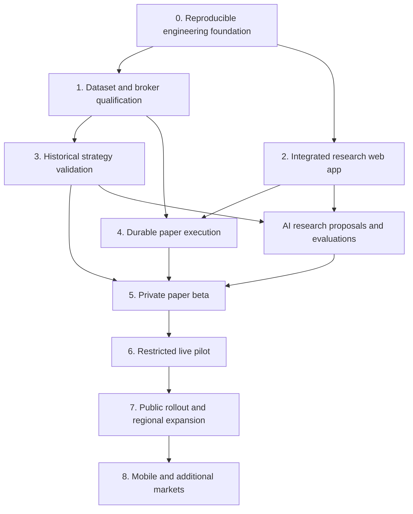

# Project roadmap

Updated: 4 November 2026. Planning baseline, not a delivery-date or profitability promise. Product name remains undecided; “Axiom” is a prototype placeholder.

## Where we are

We have a product direction, a clickable web prototype, broker/strategy desk research, and a backend-connected synthetic research flow. The Research lab can submit a durable job to a Python API and separate worker and display its actual result. Thirteen Python tests passed on 4 November using SQLite; Compose definitions exist but Docker/PostgreSQL runtime checks remain open. We do not yet have an integrated trading application. The Rust validator is written but uncompiled because toolchain downloads stalled after the disk-space problem was resolved. See DEVELOPMENT.md for setup and precise verification limits.

Status vocabulary: **verified** means the stated local behavior was checked; **partial** means an artifact exists but its acceptance criteria are incomplete; **planned** means not implemented. A design document is not evidence that its controls exist. We will measure progress by accepted milestones rather than invent a percentage complete.

| Area | Status | Evidence and limits |
| --- | --- | --- |
| Product scope and architecture | Partial | PROJECT-BRIEF.md and SYSTEM-BLUEPRINT.md; providers, engine and launch-country decisions remain open |
| Web experience | Verified prototype | prototype/dist: sample-data screens, dark/light themes and paper interaction demos; no backend, login or broker |
| Python session-breakout replay | Verified fixture behavior | run_replay.py, src/tradinglab/replay.py and tests/test_replay.py; synthetic candles only, not proven alpha |
| Python risk-contract validation | Verified fixture behavior | 17 shared acceptance/rejection vectors within eight passing Python tests; fixed USD fixture policy |
| Rust risk validator | Partial | execution/src/main.rs; no compilation or parity evidence yet, no broker submission path |
| Broker coverage | Partial | research/BROKER-ASSESSMENT.md: dated desk research, no qualified Nigerian route or commercial integration approval |
| Open-source strategy evaluation | Partial | Pinned source collection and license/source review; no reproduced historical performance or selected engine |
| Quant research capability | Available guidance | Backtesting, risk metrics, strategy adaptation, exposure and FX skills installed; guidance is not a completed statistical evaluation |
| AI design | Planned implementation | AI-STRATEGY-DESIGN.md; no provider connection, proposal service or evaluations |
| Business economics | Assumption model | research/business: hypothetical costs/revenue/profit, no measured demand, spending or profit |
| Research jobs and development containers | Partial | Durable research-job schema/API/worker verified locally with SQLite; Compose PostgreSQL and images unverified; other screens remain samples |
| Accounts, broker lifecycle, production deployment | Planned | No production identity, persistent order service or deployed trading backend |

## Scope and sequence

The destination is a multi-user platform for both beginners and experienced traders, with user-approved and automatic trading, global country-by-country broker coverage, multiple asset classes, AI research assistance, web first and mobile later.

The first integrated release is narrower: a private paper-trading web app, a qualified Nigeria-compatible demo route, EURUSD/GBPUSD research, one explicit strategy baseline, durable order records and visible risk decisions. This validates the platform before multiplying brokers, assets or countries. The initial instrument set is a development scope, not a permanent limit.

AI research can progress alongside paper engineering. It does not unlock live trading by itself. A strategy that fails validation is revised or rejected; the roadmap does not require promoting a losing candidate to keep a date.

## Milestones and acceptance gates

### 0 — Reproducible engineering foundation

**Deliver:** working Rust toolchain, compiled validator, Python/Rust contract parity, documented setup, dependency lock strategy, automated checks and a versioned source baseline. Add a machine-readable order schema and structured rejection reasons; current validators are fixture code, not a complete public API contract. Review test gaps and the replay's deliberately restricted assumptions.

**Done when:** a clean supported environment runs replay and both language test suites, all shared vectors agree, malformed/oversized inputs fail closed, build commands are recorded, and required checks run automatically. Explicitly track currently unsupported behavior rather than silently generalizing fixture code.

**Dependencies:** compiler downloads and linker/toolchain availability. No paid service or broker credentials required.

### 1 — Data and broker qualification

**Deliver:** one licensed/authorized historical bid/ask dataset, normalized instrument specifications, data-quality report and a broker demo capability record. Check Nigeria residence, exact legal entity, current regulator record, API-compatible products, commercial multi-user permission, authorization model and data display/storage rights. Retain dated evidence and unresolved items. Demo permission and live approval are separate.

**Done when:** dataset provenance/rights and timestamp semantics are recorded; gaps, duplicates, spreads, timezone and session coverage are measured; a permitted demo account can authenticate, retrieve the selected instruments and recover a connection. Record fees, quantity increments, margin and order restrictions from actual account specifications. Do not require a live deposit to finish this milestone.

**External decisions:** provider access, permitted dataset budget and owner-completed broker onboarding where required. Prepare concrete comparisons before requesting purchases or account access; never place credentials in chat.

### 2 — Integrated research web app

**Deliver:** production-oriented TypeScript web foundation using the prototype's design direction, Python API, maintained identity integration, PostgreSQL migrations and versioned research storage. Connect a real replay job to a research screen. Keep sample, synthetic, historical, demo and live data visibly distinct.

**Initial product flows:** sign in, workspace/account selection, dataset selection, strategy configuration, start/cancel research job, inspect costs/trades/rejections, compare versioned results, and see job failures. Preserve beginner explanations and an advanced workspace; include keyboard accessibility, responsive layout and dark/light themes.

**Done when:** a user can run a reproducible job through the web and inspect its backend result; another user cannot access the job, account or artifacts; retries do not duplicate jobs; cancellation/failure states are visible. No order submission is implied by completing a research run.

**Dependencies:** milestone 0; synthetic end-to-end work can begin before milestone 1 finishes. Identity, hosting and database service choices need short decision records before implementation.

### 3 — Historical strategy validation

**Deliver:** reproduce a selected upstream reference where appropriate or explicitly retain the independently authored breakout variant; compare a trend-following alternative; document source revision, license, rules and deviations. Replace fixture fees/spreads/slippage with justified models and add relevant calendar/financing/conversion behavior.

**Quant work to add:** chronological development/validation/untouched holdout splits; walk-forward analysis; experiment registry including failures and parameter-search counts; sensitivity tests; cost/slippage stress; uncertainty estimates appropriate to dependent returns; benchmarks; performance across regimes and instruments. Evaluate drawdown, after-cost returns, exposure, turnover and trade counts together. Fix the evaluation protocol before inspecting holdout outcomes.

**Done when:** results can be reproduced from dataset/version/configuration hashes; leakage and fill assumptions are reviewed; predeclared criteria determine accept/revise/reject; limitations and uncertainty accompany every result. If the final holdout informs tuning, replace it before calling a later evaluation independent.

**Dependencies:** milestone 1. No “unbeatable” or guaranteed-return claim; a positive historical result alone does not approve live use.

### 4 — Durable paper execution and account safety

**Deliver:** Rust adapter for the qualified demo route, normalized order/position events, PostgreSQL-backed intents, unique identifiers, atomic risk reservations and reconciliation. Implement manual approval and automatic-mode consent against the same server-side risk boundary.

**Controls to add:** account ownership and trading permissions; approval binding/expiry; fresh executable quotes; instrument-aware sizing/margin; pending/open portfolio exposure; configurable loss/drawdown controls with defined baselines and reset rules; auditable strategy versions; separate stop-new-orders, cancel-pending and close-position actions. Protect credentials server-side, support revocation and keep research/AI away from broker secrets.

**Done when:** demo tests cover concurrent intents, duplicate delivery, partial fills, timeout after acceptance, reconnect/restart, stale quotes, approval changes, cancellation races and unknown order states. No blind resubmission after an ambiguous timeout; reservations release only on confirmed transitions. Cross-account access tests must fail closed.

**Dependencies:** milestones 0, 1 and the account/API foundation in 2. Fixture policy is replaced with explicit trusted account/instrument configuration.

### AI workstream — Research assistant before runtime proposals

**Deliver:** provider-independent structured proposal schema, deterministic validator, bounded research tools, versioned prompts/configurations, experiment links, explanation screen, usage budgets and evaluation suite. Choose the provider/model using current capability, privacy, price and evaluation evidence; the earlier model name is a candidate, not a locked dependency.

**Done when:** malformed or unsupported proposals are rejected; retrieved text cannot alter permissions or invoke broker operations; results cite stored evidence; sensitive inputs are excluded/redacted; model outage and budget exhaustion are tested. A proposed strategy change is independently backtested and paper-tested before promotion. Deterministic risk protection works without an LLM.

**Later option:** runtime market-context/trade proposals require separate evaluation, freshness/expiry rules and explicit account permissions. Free text never becomes an executable broker command.

### 5 — Private paper beta

**Deliver:** a small invited cohort, onboarding/help, useful performance reports, notification preferences, support/feedback process and operating dashboards. Deploy a separated paper environment with CI/CD, encrypted secret handling, monitoring, backups and restoration procedure.

**Done when:** approved beta scenarios work end to end; recovery and backup restoration are demonstrated; all trading actions are attributable; broker reconciliation discrepancies are resolved; chosen reliability/latency targets and cost budgets are measured. Set the observation period and trade/sample requirements before starting; elapsed weeks alone do not establish strategy quality.

**Record:** activation, completed research runs, paper usage, retention, failures, support burden, actual cost per active account and willingness to pay. Revisit the hypothetical economics with measured inputs.

### 6 — Restricted live pilot

**Deliver:** a deliberately limited live release for approved users/countries/instruments, explicit consent, capped exposure, incident response, tested rollback and operator access controls. Confirm broker commercial approvals, market-data rights and applicable legal/privacy obligations with qualified advice for the actual operating model.

**Done when:** critical security findings are resolved following scoped independent review; recovery and reconciliation pass; paper evidence meets predefined criteria; live credentials/environments are isolated; users explicitly authorize live actions. Live performance and realized slippage are monitored separately from demo results.

**Dependencies:** milestone 5 and explicit live authorization. This roadmap does not authorize deposits, real trades, publication or purchasing services.

### 7 — Public rollout and regional expansion

**Deliver:** subscriptions/billing/entitlements, receipts/refunds and support processes, usage controls, public status/help, privacy and retention workflows, production capacity planning and operational ownership. Re-estimate economics from measured service usage and commercial contracts before setting final pricing.

**Expansion gate per country/broker:** verified eligibility/entity, products, authorization/commercial terms, data rights, integration tests, support and operational readiness. Maintain a capability matrix so users see only permitted routes. Add the next broker for an evidenced coverage gap rather than connector count.

**Done when:** the specific release cohort has a supported broker/product path, tested onboarding and revocation, sustainable support and monitored operating costs. Global ambition is implemented through qualified releases, not a single worldwide switch.

### 8 — More assets and mobile

**Deliver:** individual stocks, selected gold/oil products and further FX coverage with asset-specific contracts, calendars, corporate actions/futures rolls where relevant, conversions, fees, margin and data entitlements. Decide whether each gold/oil offering is a CFD, future, ETF or another product before implementation.

Build mobile on the proven shared APIs, adding secure session/device handling, accessible workflows, notification controls, app-store delivery and mobile-specific testing. Keep broker credentials on the server. Decide mobile framework using actual web/API reuse and product needs.

**Done when:** each asset/adapter passes its own research, lifecycle and risk tests; mobile account/approval flows pass the same authorization gates as web. Multi-asset and mobile are independent increments after the core is stable.

## Stack decision register

| Layer | Current direction | Remaining decision |
| --- | --- | --- |
| Web | TypeScript/React; Next.js proposed | Confirm framework/deployment approach before production scaffold; prototype is buildless JS |
| API/research | Python; FastAPI proposed | Job execution/isolation, typed API contracts and selected backtest engine |
| Execution | Rust accepted | Finish build; custom lifecycle versus reviewed reusable engine |
| Transactional data | PostgreSQL planned | Hosting, migrations, ownership model, recovery objectives and retention |
| Historical data/artifacts | Versioned files, Parquet/object storage proposed | Dataset rights, schema and measured query/storage needs |
| Identity/secrets | Maintained identity provider and managed secret handling | Provider, MFA/session features and operating model |
| AI | Provider adapter with gated proposals | Evaluation-based model choice, privacy and spending cap |
| Operations | Automated checks, separated paper/live environments | Hosting region, monitoring, backups and deployment design |

No extra language, database or service is added without a concrete need. Use existing architecture and requirements documents for detailed responsibilities; record departures and their reasons here.

## Working rhythm

Use WORK-QUEUE.md as the small actionable queue. Keep one primary end-to-end objective active; research/access work may proceed alongside it without duplicating implementation. Each task needs a concrete outcome, relevant checks, dependencies and evidence of completion. Update this roadmap only when a milestone changes status or scope.

For every completed increment record: what changed, how it was tested, remaining limits, and the next dependency. Keep build/data/configuration versions with results. Commit reviewable increments once repository workflow is established; never include secrets or purchased datasets without permitted rights.

Plan milestone dates after the engineering foundation and first provider-access checks establish real throughput. Dataset approvals, broker approvals, statistical evidence and independent review are external/variable dependencies. Assign calendar targets to bounded engineering tasks; do not promise live launch dates or returns from this planning document.

## Immediate next outcome

**A reproducible web research run:** finish Rust/Python parity and the contract first, then connect the Python replay to a typed API and web research screen using synthetic fixtures. In parallel qualify the historical dataset and Nigeria demo route. This produces a usable integrated increment without waiting for broker approval or pretending synthetic results demonstrate profitability.
