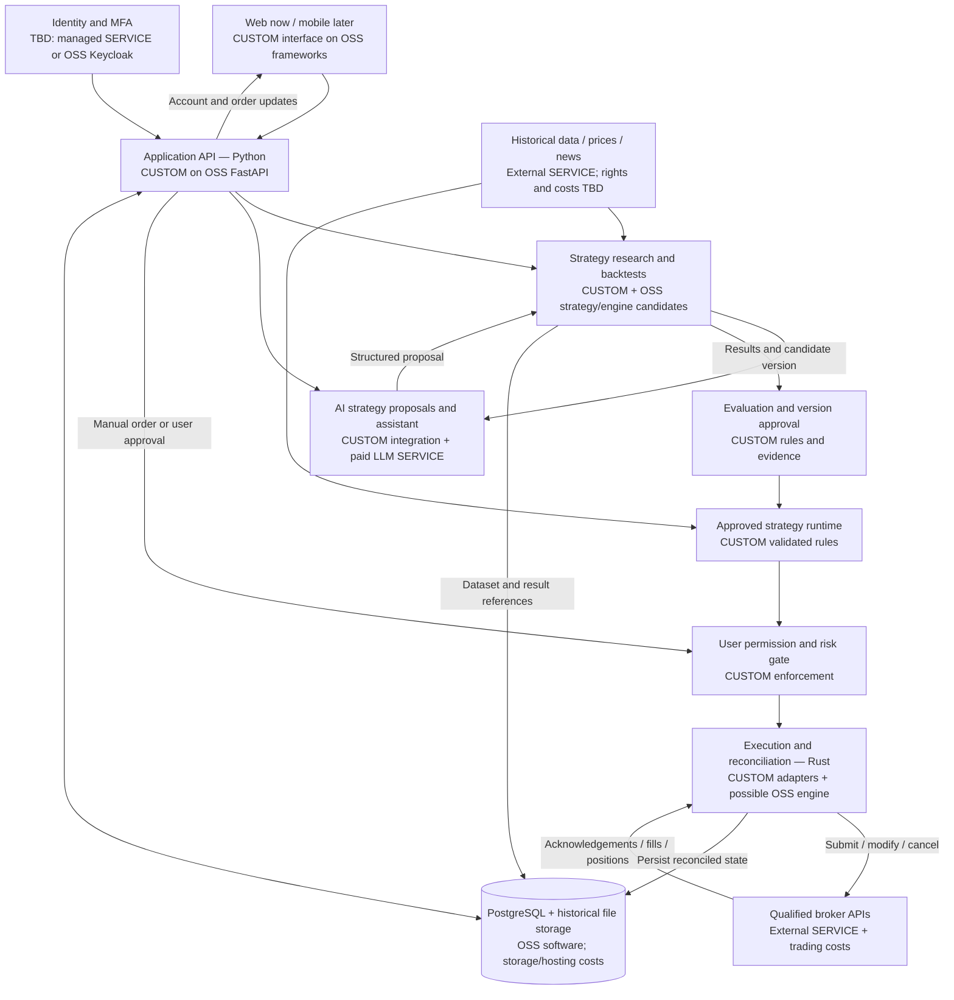
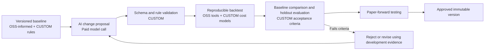

# Trading platform blueprint and build-versus-buy map

Version 0.1 · 3 November 2026. Working design reference; not a deployed architecture. Rust is agreed for execution. Other named products are proposals/candidates unless explicitly marked selected. No purchases or paid services have been activated.

## Legend and decision rules

- **CUSTOM:** our application-specific code and integration work. Development, maintenance, and hosting still cost effort/money. This label does not predetermine how our own source will be licensed.
- **OSS:** reuse an open-source component under its license. No license subscription is implied; operation, support, data, and commercial services can still cost money.
- **SERVICE:** an external provider, normally billed by subscription, consumption, usage, or trading activity. Some offer free tiers.
- **TBD:** provider/product or reuse decision is not yet final. Components can combine CUSTOM, OSS, and SERVICE rather than belonging to only one category.

## General architecture

The diagram shows logical responsibilities, not a requirement to create a separate microservice for every box. Start with one Python application/research codebase and a Rust execution process. Split further only when operational requirements justify it. The database does not issue orders. The broker remains authoritative for its fills and account state.

Authentication, server-side account authorization, secret management, observability, backups, and deployment infrastructure apply across these responsibilities. Broker credentials stay in a restricted server-side credential service/secret store; neither browsers nor AI research workers receive them. Research reads versioned historical data rather than production broker secrets.

## Strategy improvement cycle

Final holdout data/results are not fed into iterative AI tuning. If they are used to revise a candidate, that holdout is no longer independent. No auto-promotion on a model's recommendation. NFI is not the primary research baseline; current candidates are non-crypto trend rules and FX session breakout, with equity-specific research.

## Live order path

```mermaid
flowchart LR
  S["Manual order or approved strategy signal"] --> U["Account permission / required user approval"]
  U --> R["Fresh data, sizing, margin, exposure checks"]
  R --> I["Durable intent + atomic risk reservation"]
  I --> E["Rust broker adapter"]
  E --> B["Broker acceptance / rejection"]
  B --> F["Fill events and reconciliation"]
  F --> D["Persist and publish account updates"]
```

Measure strategy calculation, risk/persistence, network acknowledgement, and fill latency separately. Neither a language choice nor the diagram guarantees microsecond end-to-end fills. Unknown submission outcomes require reconciliation before retry; cancellations and exits require confirmed broker outcomes. Existing risk protection must work during model outages. Runtime AI proposals remain a later evaluated capability under AI-STRATEGY-DESIGN.md.

## Build, reuse, and pay inventory

| Component | Build/reuse decision | Software or access cost | Operating cost / unresolved choice |
| --- | --- | --- | --- |
| User interface | CUSTOM design/components using OSS React, TypeScript, proposed Next.js | No framework license subscription planned | Web hosting, bandwidth, build infrastructure; mobile later |
| Charts | Reuse OSS TradingView Lightweight Charts; CUSTOM data/order overlays | Apache-2.0 component; comply with applicable attribution/notices | Market-data feeds and our integration; Advanced Charts/Trading Platform are different products, not assumed included |
| Python application API | CUSTOM domain services using OSS FastAPI/Pydantic | Open-source libraries | Always-on compute, logs, API bandwidth |
| Rust execution | CUSTOM risk policies, lifecycle, reconciliation, and broker adapters; evaluate OSS NautilusTrader engine | Rust toolchain is not a paid execution service; NautilusTrader is LGPL-3.0 licensed | Compute near chosen broker endpoints, resilient storage/networking, monitoring; no engine adoption finalized |
| Strategy logic | Reuse reviewed OSS rules as appropriate; CUSTOM complete strategies/variants and tests | pysystemtrade GPL-3.0; London Breakout repository Apache-2.0; obligations depend on actual reuse | Suitable historical data, research compute, storage, maintenance; no proven strategy purchased or selected |
| Backtest/data processing | OSS numerical/query tools, selected engine; CUSTOM dataset normalization and execution/cost modeling | No mandatory commercial backtester selected | Data licenses, compute and storage; engine selection pending |
| PostgreSQL | Reuse OSS PostgreSQL; CUSTOM schema, permissions, migrations | PostgreSQL license permits use without a license fee | Local development can use existing hardware; managed DB/backup costs in production. Supabase is an optional hosting/service choice, not required by the installed skill |
| Historical files | Parquet files; OSS query tools such as DuckDB/Polars as needed | No format subscription | Object storage, requests, transfer, retention, and licensed data |
| AI assistant and strategy proposals | CUSTOM prompts, retrieval, schemas, evaluation, and provider adapter; GPT-6.1 Sol proposed | Paid API inference; tool usage may add charges | Token volume, output size, tools, retention and network. No need to call an LLM for every tick or deterministic order |
| Identity/MFA | Reuse a maintained identity system; CUSTOM account authorization | Managed service: free/paid plans; OSS Keycloak alternative | Required MFA/session features, emails/SMS, user volume, hosting and operational responsibility; provider TBD |
| Broker connections | CUSTOM integration over broker-approved APIs | Broker/platform/commercial terms vary; a publicly documented API is not necessarily cost-free commercial access | Spreads, commissions, financing, data/exchange fees, minimums and country/entity restrictions |
| Market prices/history/news | Buy/license permitted feeds or use broker data where terms allow | Free/demo access may be restricted; production/commercial redistribution may be paid | Coverage, asset class, tick depth, point-in-time quality, retention, display/redistribution rights; providers TBD |
| Deployment/security infrastructure | Reuse hosting, secret manager/KMS, monitoring and backup services; CUSTOM deployment/access policies | Managed billing or OSS software choices | Servers, encrypted backups, egress, alerts, log retention, domains, email and recovery; providers TBD |
| Development/quality tools | Reuse Git, compilers, browser testing and security scanners | Many OSS tools; some hosted features/desktop products have paid plans | CI minutes, artifact retention, private features, independent security review. Docker Desktop eligibility differs from running OSS container tools on Linux |

Custom code ownership and OSS license compliance must be tracked per dependency; "open source" does not mean no obligations. A port to another language does not automatically remove upstream license requirements. Final licensing decisions require the exact component, version, modifications and distribution model.

## Current priced examples, not a project budget

Checked against vendor pages on 3 November 2026; USD, subject to vendor terms and changes. No plan is selected or purchased.

- **GPT-6.1 Sol:** the model page lists $2 per million input tokens and $10 per million output tokens at standard listed rates. A hypothetical 1 million billable input tokens plus 200,000 billable output tokens is $4 for those tokens alone; additional tools, taxes and other usage are excluded. Actual billing must count all applicable tokens, including billed reasoning where relevant. [Model pricing](https://developers.openai.com/api/docs/models/gpt-6.1-sol).
- **Supabase:** a Free plan is available with limits, and Pro starts at $25/month with usage-dependent charges. It is one managed PostgreSQL/service option, not a mandatory expense. [Pricing](https://supabase.com/pricing).
- **Clerk:** a free plan is available; the current page puts MFA in Pro, so free login does not establish that our security requirements are covered. Review billing interval and features before estimating. No identity provider chosen. [Pricing](https://clerk.com/pricing).
- **Keycloak:** an open-source identity alternative. Self-hosting moves responsibility and cost to us; it is not a zero-cost substitute for operating identity securely. [Project](https://www.keycloak.org/).

Do not invent a monthly production total until broker/data rights, hosting region, recovery requirements, account/user volume, and model usage are specified. Paid data and reliable operations can matter more than framework costs. Free development access is not a production availability or licensing guarantee.

## Suggested spending sequence

1. Local prototype, schemas, risk fixtures, and tests on existing hardware: avoid adding subscriptions merely to start.
2. Research datasets: verify rights and quality before paying for long histories or optimizing strategies. Start with permitted samples where possible.
3. AI evaluation: connect a provider with a capped usage configuration after account access/data handling is established; use synthetic or non-sensitive fixtures initially.
4. Broker demo: qualify authorization, country access, instrument coverage, data rights, and failure/reconciliation behavior.
5. Private paper environment: select hosting, managed identity/database or a supported self-hosted setup, backups and monitoring based on actual requirements.
6. Live release: independently assess security and operational recovery, verify broker/jurisdiction permissions, and budget ongoing execution/data/hosting costs.

## Build from scratch where it differentiates the product

Our main custom work is the user experience, account permissions, normalized instrument/broker model, strategy proposal schema, experiment/version registry, strategy variants, evaluation reports, risk rules, order-state coordination, broker adapters, and decision explanations. Reuse established chart rendering, database, cryptographic primitives, identity protocols/providers, and suitable execution/backtest infrastructure. Build custom integrations around these rather than inventing a new database, authentication protocol, or encryption scheme.

## Sources and maintained references

- [React license](https://github.com/facebook/react/blob/main/LICENSE)
- [Next.js license](https://github.com/vercel/next.js/blob/canary/license.md)
- [FastAPI license](https://github.com/fastapi/fastapi/blob/master/LICENSE)
- [PostgreSQL license](https://www.postgresql.org/about/licence/)
- [Lightweight Charts](https://www.tradingview.com/lightweight-charts/)
- [NautilusTrader license](https://github.com/nautechsystems/nautilus_trader/blob/develop/LICENSE)
- [pysystemtrade license](https://github.com/pst-group/pysystemtrade/blob/develop/LICENSE)
- [cTrader API](https://help.ctrader.com/open-api/)
- [Docker plans](https://www.docker.com/pricing/)
- Project-specific execution/security requirements: ENGINEERING-REQUIREMENTS.md
- AI permissions, proposal lifecycle and failure behavior: AI-STRATEGY-DESIGN.md
- Broker eligibility and integration evidence: research/BROKER-ASSESSMENT.md
- Strategy sources, licenses and outstanding validation: research/NON-CRYPTO-AND-AI-DIRECTION.md
